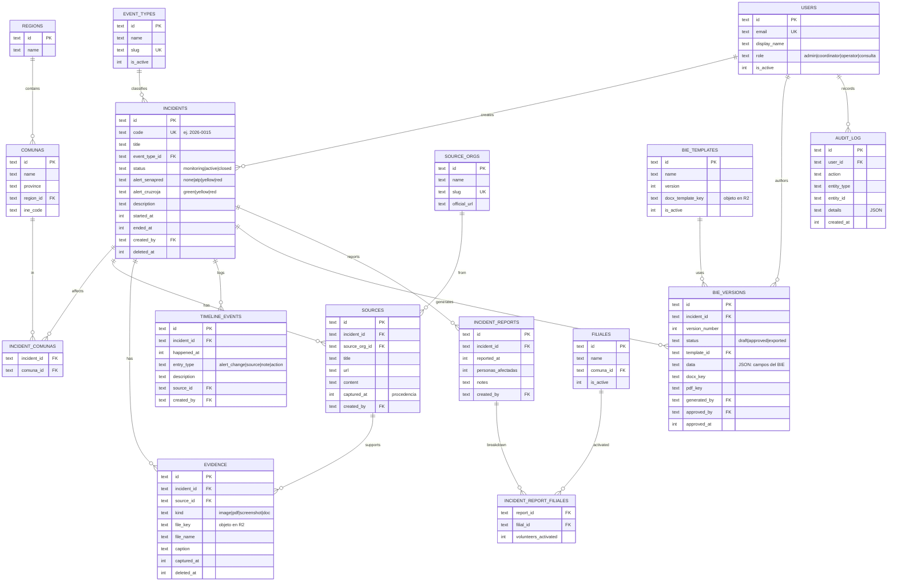

# Base de datos — Centinela (SoleilTech)

> Modelo del dominio (ERD "en papel") como **contrato**: los mocks del frontend
> y luego Turso lo respetan. Motor: **Turso (libSQL/SQLite)**. Las migraciones y
> seeders se implementan en la etapa de backend; aquí va el diseño.

## 1. Modelo entidad-relación

## 2. Tablas y justificación (una línea cada una)

| Tabla | Para qué existe |
|---|---|
| `users` | Usuarios del equipo (2–6) con su rol. |
| `regions` / `comunas` | Jerarquía geográfica (modelada para escalar a nivel país). |
| `event_types` | Catálogo de tipos de evento (sistema frontal, incendio, sismo…). |
| `source_orgs` | Catálogo de fuentes oficiales (SENAPRED, DMC, SHOA, CONAF…). |
| `incidents` | **Objeto central**: la emergencia, con doble alerta y ciclo de vida. |
| `incident_comunas` | Pivote N:M — un incidente afecta varias comunas. |
| `sources` | Comunicados/enlaces por incidente, con **procedencia** (org + url + captured_at). |
| `evidence` | Archivos (imágenes, PDF, capturas) por incidente, guardados en R2. |
| `timeline_events` | **Cronología append-only** del incidente (incluye cambios de alerta). |
| `bie_templates` | Plantillas `.docx` del BIE, versionadas (RF-19/25). |
| `bie_versions` | Cada BIE generado (N por incidente), con flujo de aprobación. |
| `audit_log` | **Bitácora append-only**: quién hizo qué y cuándo (RF-14). |
| `filiales` | Catálogo de filiales de Cruz Roja de la región. |
| `incident_reports` | **Reportes de situación** (snapshots de métricas en el tiempo → historia para comparar). |
| `incident_report_filiales` | Voluntarios activados **por filial** en cada reporte. |

## 3. Detalle de tablas núcleo

### incidents
| Columna | Tipo | Restricciones |
|---|---|---|
| id | TEXT | PK (UUID/ULID) |
| code | TEXT | UNIQUE, NOT NULL (correlativo legible) |
| title | TEXT | NOT NULL |
| event_type_id | TEXT | FK → event_types |
| status | TEXT | CHECK in (monitoring, active, closed) |
| alert_senapred | TEXT | CHECK in (none, atp, yellow, red) |
| alert_cruzroja | TEXT | CHECK in (green, yellow, red) |
| description | TEXT | |
| started_at | INTEGER | NOT NULL (epoch ms) |
| ended_at | INTEGER | NULL |
| created_by | TEXT | FK → users |
| created_at / updated_at | INTEGER | NOT NULL |
| deleted_at | INTEGER | NULL (soft-delete) |

Índices: `event_type_id`, `status`, `alert_senapred`, `alert_cruzroja`, `started_at`.

### incident_reports (métricas con historia)
Snapshot de situación por incidente, **append-only**: `incident_id` FK,
`reported_at`, `personas_afectadas` (INT), `notes`, `created_by`, `created_at`.
Cada reporte nuevo conserva los anteriores → **comparación en el tiempo**.
Los **voluntarios por filial** van en `incident_report_filiales`
(`report_id` FK, `filial_id` FK, `volunteers_activated` INT; PK compuesta
report_id+filial_id).

El **dashboard (RF-12)** lee el **último reporte** de cada incidente:
`personas_afectadas` directo; `voluntarios_desplegados` = **suma** de
`volunteers_activated`; `filiales_activadas` = número de filiales con voluntarios.
(Se derivan → no se duplican como columnas en `incidents`.)

### sources (procedencia)
`incident_id` FK, `source_org_id` FK, `title`, `url`, `content` (texto pegado),
`captured_at` (procedencia), `created_by`, `created_at`. Índice: `incident_id`.

### evidence
`incident_id` FK, `source_id` FK (nullable), `kind` CHECK(image|pdf|screenshot|doc),
`file_key` (R2), `file_name`, `mime_type`, `size_bytes`, `caption`, `url`,
`captured_at`, `created_by`, `deleted_at`. Índice: `incident_id`.

### timeline_events (append-only)
`incident_id` FK, `happened_at`, `entry_type`
CHECK(alert_change|source|note|action), `description`, `source_id` FK (nullable),
`created_by`, `created_at`. **Sin update/delete.** Índice: `incident_id`, `happened_at`.

### bie_versions
`incident_id` FK, `version_number`, `status` CHECK(draft|approved|exported),
`template_id` FK, `data` (JSON con **todos los campos del BIE**, ~45 según el
formato oficial: datos oficiales, afectación, los **16 títulos** de la descripción,
filiales/voluntariado, necesidades, cierre y firma), `docx_key`/`pdf_key` (R2), `generated_by`
FK, `approved_by` FK (nullable), `approved_at`, `created_at`, `deleted_at`.
Único: (`incident_id`, `version_number`). Índice: `incident_id`.

### audit_log (append-only)
`user_id` FK, `action`, `entity_type`, `entity_id`, `details` (JSON), `created_at`.
**Sin update/delete.** Índice: `user_id`, `created_at`.

### users
`email` UNIQUE, `password_hash` (o gestionado por la librería de auth),
`display_name`, `role` CHECK(admin|coordinator|operator|consulta), `is_active`,
`created_at`, `last_login_at`.

## 4. Decisiones transversales

- **Métricas vs. narrativa:** las **métricas** (personas afectadas, voluntarios,
  filiales) son **campos estructurados** (en `incident_reports`) → el dashboard
  las suma y grafica; los **campos narrativos del BIE** quedan **flexibles**
  (JSON en `bie_versions.data`). En ambos casos, cada actualización **conserva
  los reportes/versiones anteriores** para comparar.
- **IDs:** TEXT (UUID v4 o ULID) generados en el backend → aptos para offline/merge
  y no exponen conteos. El correlativo legible (`incidents.code`) es aparte.
- **Timestamps:** `created_at`/`updated_at`; INTEGER epoch ms (Drizzle).
- **Enums:** SQLite no tiene enum → **TEXT + CHECK**.
- **Append-only:** `audit_log`, `timeline_events` e `incident_reports` — solo se
  insertan (sin update/delete) → trazabilidad, historial de alertas y de métricas.
- **Soft-delete:** `incidents`, `evidence`, `bie_versions` con `deleted_at`.
- **FKs:** `PRAGMA foreign_keys=ON`.
- **Procedencia (RF-13):** atributos (org + url + `captured_at`) en `sources` y
  `evidence` — sin tabla aparte.
- **Auth/sesiones:** tablas gestionadas por la librería de auth (Better Auth);
  `users.role` es de nuestro dominio.
- **Normalización:** 3FN; único desvío `comunas.province` como texto.
- **Reglas del BIE (formato oficial):** cada dato lleva **fuente + hora**; `N/A`
  (no aplica) vs `En evaluación` (sin dato oficial); **privacidad dura** (nunca
  teléfonos ni datos personales sensibles de afectados/voluntarios);
  `alerta_cruz_roja` por defecto **VERDE**; correlativo `N° BIE`; campos fijos
  (Región de Valparaíso · Comité Regional · Autorizado por **Ive Manni** ·
  Directora Regional de Gestión del Riesgo · Equipo de Monitoreo Regional).

## 5. Migraciones y seeders (etapa backend)

- **Migraciones:** con drizzle-kit, corren de cero sin errores.
- **Seeders:**
  - `regions` + `comunas`: las 38 comunas de la Región de Valparaíso.
  - `event_types`: sistema frontal, tormenta eléctrica, incendio, sismo, tsunami,
    marejada, aluvión/remoción, viento, nevada, temperatura extrema, corte
    eléctrico, corte de agua, otros.
  - `source_orgs`: SENAPRED, DMC, SHOA, CSN, CONAF, SEC, Esval, MOP, Delegación
    Presidencial, Carabineros.
  - `filiales`: las filiales de Cruz Roja de la Región de Valparaíso.
  - `bie_templates`: una plantilla por defecto (tu formato actual del BIE).
  - `users`: un usuario admin inicial.

> Los catálogos (comunas, **20 filiales** con mapa comuna→filial, y fuentes
> oficiales) se toman de las referencias de la skill `monitoreo-bie-valparaiso`
> (`filiales-y-comunas.md`, `fuentes-oficiales.md`).

## 6. Futuro (no en el MVP)

`notifications` (RF-24), `provinces` normalizada, **otros tipos de documento /
referencias** además del BIE (punto abierto de Nicolás), y tablas de recursos
(vehículos, inventario) o multi-organización — se agregan **sin romper el núcleo**.
